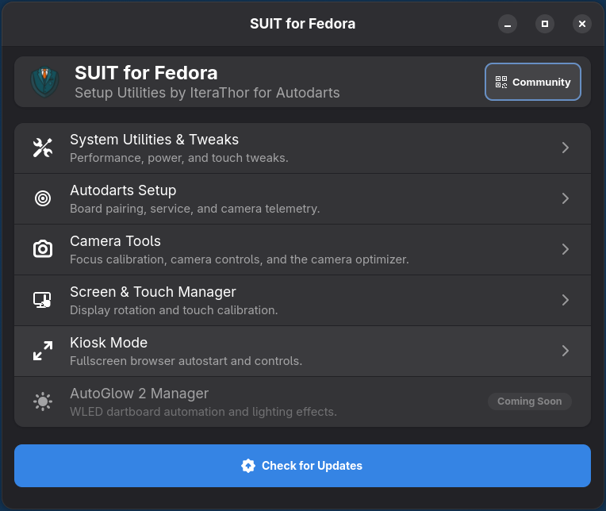
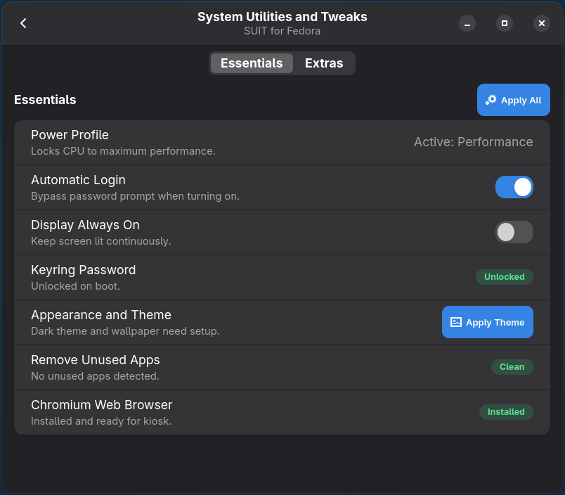
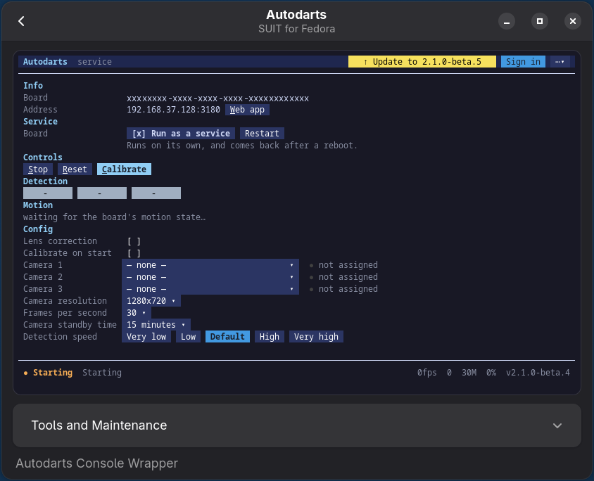
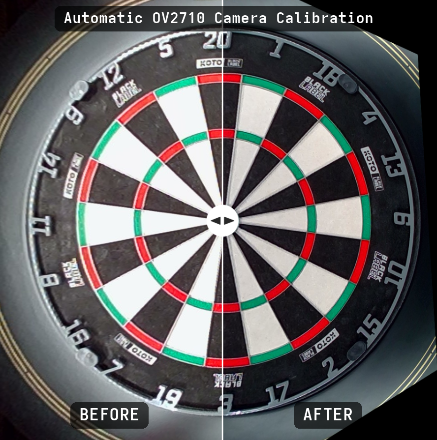
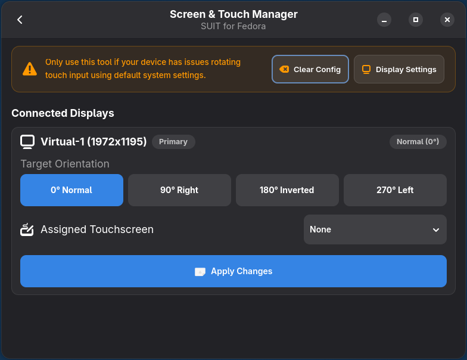
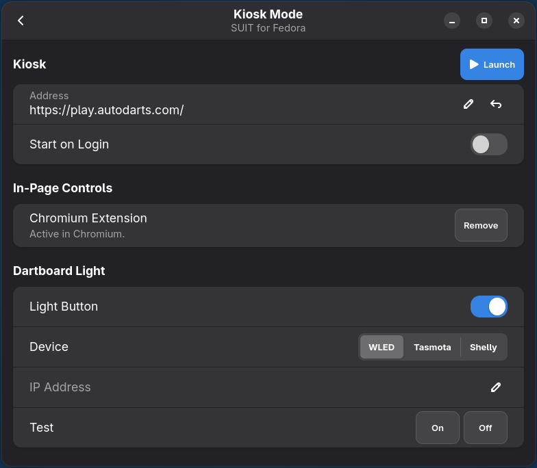

<div align="center">
  
  <h1>SUIT for Autodarts</h1>
  <p><strong>Setup Utilities by IteraThor — Fedora and Ubuntu Desktop</strong></p>
</div>

> **Community development branch:** This is JohanAlvedal's Ubuntu support proposal
> based on [IteraThor/SUIT](https://github.com/IteraThor/SUIT). The Ubuntu port is
> under development and has **not yet been validated on physical hardware**.
> Features described below are inherited from upstream and may not work on both
> distributions yet.

## Platform status

| Platform | Status | Notes |
| --- | --- | --- |
| Fedora Workstation | Original upstream target | The installer retains `dnf`; Fedora regression testing is still needed for this fork. |
| Ubuntu Desktop 24.04 LTS or newer (GNOME) | Experimental | Installer uses `apt`; graphical and camera tests still needed on a real machine. |
| Ubuntu 22.04 and older | Not supported | SUIT uses `Adw.NavigationView`, which requires libadwaita 1.4 or newer. |

## Installation

Install from a **logged-in graphical desktop session**. Use the steps for your
distribution below. SUIT is a management GUI; install/configure Autodarts itself
separately.

### Ubuntu Desktop (24.04 LTS or newer)

```bash
git clone --branch feature/ubuntu-support https://github.com/JohanAlvedal/SUIT.git
cd SUIT
./install.sh --check     # Safe preview: does not change the computer
./install.sh             # Uses apt and creates a SUIT application launcher
```

### Fedora Workstation

```bash
git clone --branch feature/ubuntu-support https://github.com/JohanAlvedal/SUIT.git
cd SUIT
./install.sh --check     # Safe preview: does not change the computer
./install.sh             # Uses dnf and creates a SUIT application launcher
```

After installation, launch **SUIT (Autodarts)** from the application menu.

**Important:** The installer does not uninstall the previous SUIT version,
change sudoers, disable screen locking, reset keyrings, or change Autodarts
services. Its only privileged additions are distribution packages and the
`se.alvedal.suit.helper` Polkit action for SUIT's validated helper.

### What currently differs between platforms?

| Function | Fedora | Ubuntu |
| --- | --- | --- |
| GTK4/libadwaita dashboard | Upstream implementation | Ported; hardware testing pending |
| Camera focus and board utilities | Upstream implementation | Hardware testing pending |
| Screen orientation and touch | Upstream implementation | Hardware testing pending |
| Browser kiosk | Upstream implementation | Chromium Snap behavior requires testing |
| Permanent Chromium in-page controls | Upstream implementation | Disabled pending Snap compatibility work |
| System-wide **Apply All** | Upstream workflow | Disabled to prevent unsafe bulk changes |
| Automatic application removal (debloat) | Upstream workflow | Disabled pending package review |
| Automatic Waydroid install | Upstream workflow | Disabled pending platform review |
| Fast Boot (dracut/GRUB/unit masks) | Upstream implementation | Hidden; not ported (initramfs-tools, update-grub) |
| Minimal Desktop shell extension | Upstream implementation (GNOME 49+) | Available on GNOME 49+ only (Ubuntu 25.10 and newer); disabled on 24.04 |
| Hardware Overlay shell extension | Upstream implementation | Ported (GNOME 45+); hardware testing pending |
| AutoGlow 2 Manager | Upstream implementation | Uses one Polkit prompt per privileged step; hardware testing pending |
| Repair after system upgrade | Upstream workflow (Fedora upgrades) | Not run on Ubuntu |
| English/German UI | Upstream implementation | Same |

The fork also removes the original broad **passwordless sudo** setup on both
platforms. Privileged operations may ask for authentication, and some older
system utilities still need follow-up changes and testing.

See [Ubuntu setup, caveats and validation](docs/ubuntu.md) for details.

## Keeping your installation updated

SUIT's built-in updater in this branch attempts a fast-forward on the **current
checked-out branch only**. It refuses to discard local changes. Until Ubuntu
support is merged upstream, continue using this fork's development branch.

## Optional uninstall tool (from upstream)

The repository now includes `./uninstall.sh` for deliberate, manual removal.
Run it from a terminal on the dartboard PC's desktop. It removes SUIT's
services, launchers, helper and touch rule, restores the desktop settings SUIT
changed (theme, touch tweaks, display sleep, power profile) and asks before
turning off automatic login or resetting the screen rotation. Autodarts itself
is never touched. The `--purge` mode also deletes saved settings.

---

## Features & Modes

### 1. Main Dashboard
Modern Libadwaita touch menu providing rapid access to all system tools and live status.

<div align="center">
  
</div>

* Large 44px+ touch targets optimized for touchscreens.
* Quick access to community resources, Discord, and 3D print models.
* Integrated one-click update checker.

---

### 2. System Utilities & Touchscreen Tweaks
One-click performance, display, and desktop optimizations for dartboard machines. The **Essentials** tab holds everything *Apply All* sets up; the **Extras** tab has the optional tweaks (touchscreen tweaks, minimal desktop, Fast Boot, hardware overlay, advanced tools).

<div align="center">
  
</div>

* **Touchscreen Tweaks**: Enlarges GNOME top bar to 54px, expands button touch padding, enables On-Screen Keyboard (OSK), and restores window Minimize/Maximize buttons across Chromium and desktop apps.
* **Minimal Desktop**: One switch for a cleaner rig desktop: a dock with your favorite and running apps sits on the wallpaper (windows simply cover it), and top bar icons and quick settings a dart machine never needs (accessibility, microphone, power mode, night light, dark style, do not disturb) are hidden. When AutoGlow 2 is installed, an **Autoglow 2** button next to Wi-Fi opens its web interface.
* **Performance Profile**: Locks CPU governors to high-performance mode to minimize dart detection latency.
* **Display Keepalive & Auto-Login**: Bypasses screen blanking, sleep timeouts, and login password prompts.

---

### 3. Autodarts Setup
The official Autodarts v2 console, embedded and sized to fit, plus install and maintenance tools.

<div align="center">
  
</div>

* Everything from the Autodarts console in one page: board info and sign-in, run as a service, start / stop / reset / calibrate, cameras, resolution, FPS, standby time and detection speed.
* The console scales its font to the window, so every section is visible without scrolling.
* **Tools and Maintenance**: restart the console, and reinstall or uninstall Autodarts.

---

### 4. Camera Focus Tool
Optical calibration wizard to achieve razor-sharp focus across all 3 Autodarts cameras.

* **Sweet-Spot HUD**: Projects a green target reticle directly onto the furthest double ring wire.
* **2.5x Magnifier Lens**: Live zoomed view centered on the sweet spot for fine optical lens adjustments.
* **Sharpness Score Meter**: Normalized 0–100 score gauge with real-time peak tracking and focus trend indicators.
* **Audio Tone Guidance**: Modulates pitch dynamically as focus improves, allowing you to focus lenses while standing at the board without looking at the screen.

---

### 5. Camera Optimizer (HBV OV2710)
One-click image calibration for HBV OV2710 cameras (USB ID `0bdc:2710`), found under **Camera Tools**.

* **One click**: stops Autodarts, calibrates every camera against the empty board, matches them, and starts Autodarts again (about 2 minutes).
* **Hidden camera controls**: longest flicker-free exposure at 1× sensor gain, matched digital gain, low sharpening, and a high MJPEG quality picked by a bandwidth check across all cameras. About twice as visible darts in Autodarts' difference image on the reference rig.
* **Stays applied**: the `suit-camera-keeper` user service writes the settings before Autodarts opens the cameras and re-applies them after restarts and standby. Nothing is flashed; settings live in camera RAM.
* **Fine-tuning** afterwards on the **Camera Controls** page, with "Reset to calibrated" and a brightness check.
* **Before and after** comparison per camera, and **Restore original settings** to undo everything.

Only cameras with the HBV USB ID and a verified firmware build are touched; you confirm once that you use HBV OV2710 cameras. Profiles live in `~/.config/hbvcal`.

<p align="center">
  
</p>

---

### 6. Camera Controls
Live view and every setting of each camera, for any UVC camera, found under **Camera Tools**.

* **Every control** grouped by Exposure / Tone / Detail / Color / Stream; on confirmed HBV OV2710 cameras also JPEG quality and sensor gain.
* **Keep these settings**: per camera, re-applied by the `suit-camera-keeper` service before Autodarts opens the cameras and after every restart or standby.
* **Presets**: save the settings of all cameras under a name (e.g. day / evening light) and load them in one tap.
* **Live view** that never takes a camera away from Autodarts: while Autodarts runs, it shows Autodarts' own picture.

---

### 7. Screen & Touch Manager
Wayland display orientation and touch coordinate matrix calibration.

<div align="center">
  
</div>

* Rotate displays seamlessly between 0° Normal, 90° Right, 180° Inverted, and 270° Left.
* Automatic touch matrix calibration (`LIBINPUT_CALIBRATION_MATRIX`) via udev rules to align touch input with rotated screens.
* Discovers connected displays and touchscreen controllers automatically.

---

### 8. Fullscreen Kiosk Mode
Run Autodarts as a dedicated full-screen appliance with customized browser controls.

<div align="center">
  
</div>

* Boots Chromium directly into fullscreen mode without desktop distractions, optionally on login.
* Built-in Chromium extension adding Power, Restart, Exit and Board Configuration buttons directly into the Autodarts header.
* Optional dartboard light button for WLED, Tasmota or Shelly devices, with an On / Off test.
